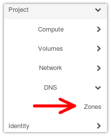
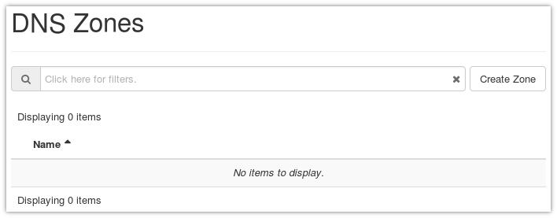
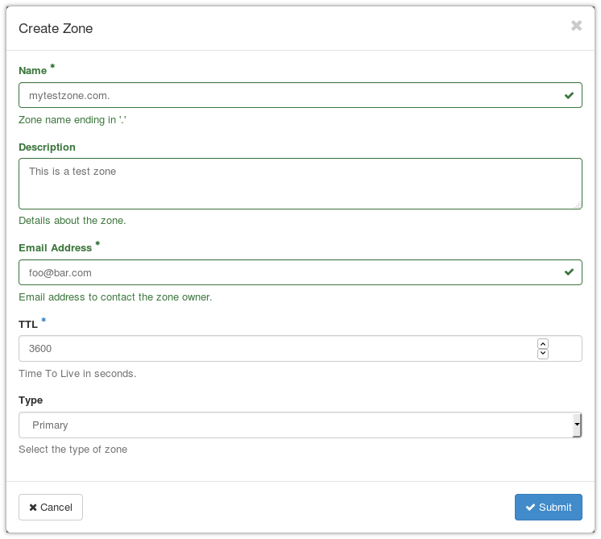
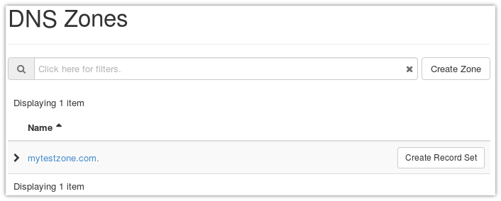
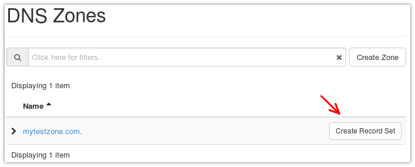
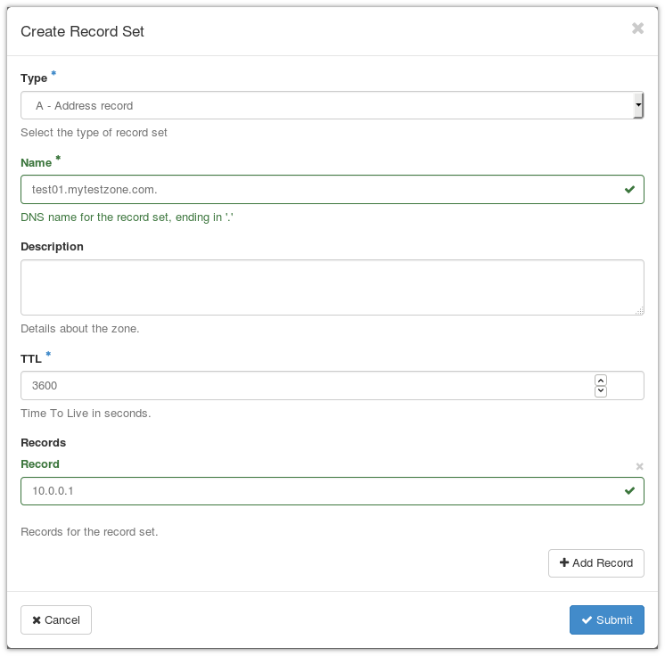
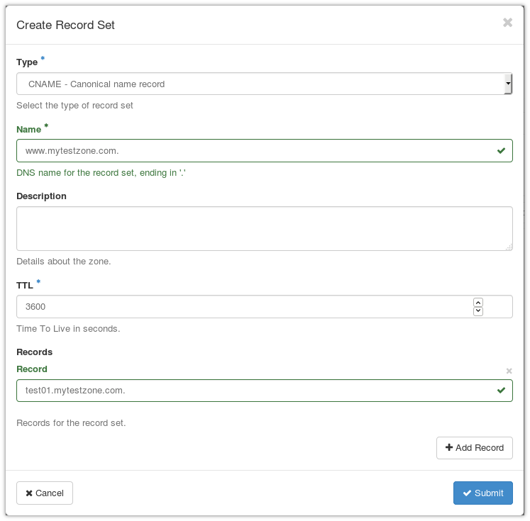
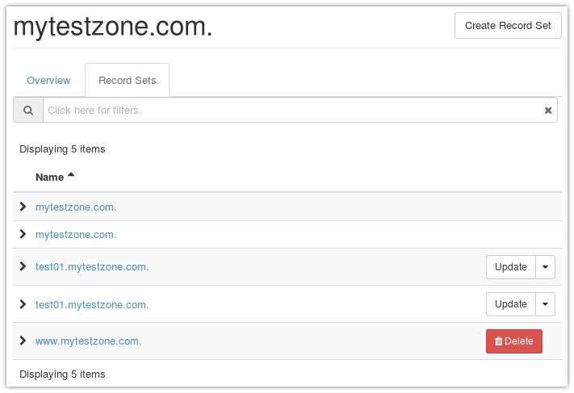

The NREC DNS service
=====================

Last changed: 2024-09-24

.. contents::

.. _this Wikipedia article: https://en.wikipedia.org/wiki/Domain_Name_System
.. _Designate: https://docs.openstack.org/designate/latest/

The NREC **DNS** (**Domain Name System**) service is based on an OpenStack component named Designate_. With this, you can create DNS zones (domain names) and DNS records within your zones. Read more about DNS in `this Wikipedia article`_.

When to use the DNS service
---------------------------

The NREC DNS service allows for the registration and management of DNS zones using the OpenStack GUI, API and command line interface (CLI). Any zone can be registered and managed, provided it uses a legal top‑level domain (TLD). You may manage zones you do not own, but this is recommended only for testing.

The following lists the requirements for using the NREC DNS service for production purposes:

#. You must either own a zone or have it delegated. DNS zones can be purchased from any reputable DNS provider.
#. Instruct the DNS vendor, or the entity that is delegating this zone to you, that the authoritative DNS servers for the zone should be:

+-----------------+-------------------+--------------------------+
+ ``ns1.nrec.no`` | ``158.37.63.251`` | ``2001:700:2:82ff::251`` |
+ ``ns2.nrec.no`` | ``158.39.77.251`` | ``2001:700:2:83ff::251`` |
+-----------------+-------------------+--------------------------+

You can verify that this change has been made by the vendor, by querying DNS (example):

.. code-block:: console

   $ host -t ns mytestzone.com.
   mytestzone.com name server ns1.nrec.no.
   mytestzone.com name server ns2.nrec.no.

When these requirements are in place, you can manage the zone and its records completely using the NREC DNS service.

Special case for UiO users
~~~~~~~~~~~~~~~~~~~~~~~~~~

UiO has acquired the DNS zone **uiocloud.no**, and can delegate sub‑zones to projects using NREC. To delegate a sub‑zone of **uiocloud.no**, email hostmaster@usit.uio.no.

Accessing the DNS zones GUI panel
---------------------------------

From the dashboard menu, select **DNS → Zones**:

You will then see the zones window, which looks like this if there are no currently configured DNS zones in the project:

Creating a new zone
-------------------

In order to create a new zone, click on **Create Zone**. You will be presented with the following form:

Here, you need to fill in:

* The name of the zone, which must end with a dot (e.g., ``mytestzone.com.``).
* Email address, which will be presented to the world as the point of contact for this DNS zone.

The rest is optional or has default values that you usually don't need to adjust unless you know what you're doing. After completing the form, click **Submit** to create the zone:

Adding an A record
------------------

An **A** record maps a name to an IPv4 address.

In your zones summary, click on **Create Record Set**:

The following form will appear:

You need to fill out the following:

* Record type – **A** (address record). This is the default.
* The name of the record, which includes your zone name and ends in a dot (e.g., ``test01.mytestzone.com.``).
* The record, which is the IPv4 address that the name should resolve to (e.g., ``10.0.0.1``).

After completing the form, click **Submit** to create the record.

Adding an AAAA record
---------------------

An **AAAA** record is similar to an **A** record but maps a name to an IPv6 address.

Follow the guide for **Adding an A record** above, but:

* In the type selection, select **AAAA – IPv6 address record**.
* For the record, enter an IPv6 address (e.g., ``fd32:100:200:300::12``).

Adding a CNAME record
---------------------

A **CNAME** record creates an alias of another DNS record. In this example we alias ``www.mytestzone.com`` to ``test01.mytestzone.com``.

Click on **Create Record Set** as before. In the form, select **CNAME – Canonical name record** as the type. The name is the alias and the record is the DNS entry it points to:

Listing your DNS records
------------------------

To list a zone’s records, click the zone name and select **Record Sets**:

Testing your records
--------------------

Test a record by querying the NREC name servers (authoritative for all NREC zones). Example:

.. code-block:: console

   $ host test01.mytestzone.com ns1.nrec.no
   Using domain server:
   Name: ns1.nrec.no
   Address: 2001:700:2:82ff::251#53
   
   test01.mytestzone.com has address 10.0.0.1
   test01.mytestzone.com has IPv6 address fd32:100:200:300::12
   
   $ host www.mytestzone.com ns2.nrec.no
   Using domain server:
   Name: ns2.nrec.no
   Address: 2001:700:2:83ff::251#53
   
   www.mytestzone.com is an alias for test01.mytestzone.com.
   test01.mytestzone.com has address 10.0.0.1
   test01.mytestzone.com has IPv6 address fd32:100:200:300::12

You may use either **ns1.nrec.no** or **ns2.nrec.no**; both are authoritative for NREC zones and do not resolve external domains.

Deleting records
----------------

Deleting records is currently impossible in the GUI due to a known bug. See the CLI instructions below.

Deleting a zone
---------------

Deleting a zone (including all its records) is also currently impossible in the GUI due to a known bug. See the CLI instructions below.

---

Doing the same with CLI
-----------------------

Installing the CLI extension
~~~~~~~~~~~~~~~~~~~~~~~~~~~

On RHEL, CentOS, AlmaLinux, Rocky Linux, and Fedora, install the extension with the package manager:

.. code-block:: console

   # sudo yum install python3-designateclient

Creating a new zone
~~~~~~~~~~~~~~~~~~

Create a zone (with an authenticated OpenStack session) using:

.. code-block:: console

   $ openstack zone create --email foo@bar.com mytestzone.com.
   +----------------+--------------------------------------+
   | Field          | Value                                |
   +----------------+--------------------------------------+
   | action         | CREATE                               |
   | attributes     |                                      |
   | created_at     | 2019-01-22T14:32:57.000000           |
   | description    | None                                 |
   | email          | foo@bar.com                          |
   | id             | ffdba4fd-0e04-4edb-8756-e4944c148d0a |
   | masters        |                                      |
   | name           | mytestzone.com.                      |
   | pool_id        | 794ccc2c-d751-44fe-b57f-8894c9f5c842 |
   | project_id     | a56e80c7c777419585b13ebafe024330     |
   | serial         | 1548167577                           |
   | status         | PENDING                              |
   | transferred_at | None                                 |
   | ttl            | 3600                                 |
   | type           | PRIMARY                              |
   | updated_at     | None                                 |
   | version        | 1                                    |
   +----------------+--------------------------------------+

List zones with:

.. code-block:: console

   $ openstack zone list
   +--------------------------------------+-----------------+---------+------------+--------+--------+
   | id                                   | name            | type    |     serial | status | action |
   +--------------------------------------+-----------------+---------+------------+--------+--------+
   | ffdba4fd-0e04-4edb-8756-e4944c148d0a | mytestzone.com. | PRIMARY | 1548167577 | ACTIVE | NONE   |
   +--------------------------------------+-----------------+---------+------------+--------+--------+

Adding an A record (IPv4)
~~~~~~~~~~~~~~~~~~~~~~~~

Create an **A** record (IPv4) for ``test01.mytestzone.com`` → ``10.0.0.1``:

.. code-block:: console

   $ openstack recordset create mytestzone.com. test01 --type A --records 10.0.0.1
   +-------------+--------------------------------------+
   | Field       | Value                                |
   +-------------+--------------------------------------+
   | action      | CREATE                               |
   | created_at  | 2019-01-22T14:36:04.000000           |
   | description | None                                 |
   | id          | 6910a762-d1aa-4e48-b14e-d9c44ecb81a3 |
   | name        | test01.mytestzone.com.               |
   | project_id  | a56e80c7c777419585b13ebafe024330     |
   | records     | 10.0.0.1                             |
   | status      | PENDING                              |
   | ttl         | None                                 |
   | type        | A                                    |
   | updated_at  | None                                 |
   | version     | 1                                    |
   | zone_id     | ffdba4fd-0e04-4edb-8756-e4944c148d0a |
   | zone_name   | mytestzone.com.                      |
   +-------------+--------------------------------------+

Adding an AAAA record (IPv6)
~~~~~~~~~~~~~~~~~~~~~~~~~~~~

Create an **AAAA** record (IPv6) for ``test01.mytestzone.com`` → ``fd32:100:200:300::12``:

.. code-block:: console

   $ openstack recordset create mytestzone.com. test01 --type AAAA --records fd32:100:200:300::12
   +-------------+--------------------------------------+
   | Field       | Value                                |
   +-------------+--------------------------------------+
   | action      | CREATE                               |
   | created_at  | 2019-01-22T14:37:38.000000           |
   | description | None                                 |
   | id          | aead6644-b5e7-4f67-be23-f3ce3423c0e7 |
   | name        | test01.mytestzone.com.               |
   | project_id  | a56e80c7c777419585b13ebafe024330     |
   | records     | fd32:100:200:300::12                 |
   | status      | PENDING                              |
   | ttl         | None                                 |
   | type        | AAAA                                 |
   | updated_at  | None                                 |
   | version     | 1                                    |
   | zone_id     | ffdba4fd-0e04-4edb-8756-e4944c148d0a |
   | zone_name   | mytestzone.com.                      |
   +-------------+--------------------------------------+

Adding a CNAME record (alias)
~~~~~~~~~~~~~~~~~~~~~~~~~~~~~

Create a **CNAME** record (alias) for ``www.mytestzone.com`` → ``test01.mytestzone.com.``:

.. code-block:: console

   $ openstack recordset create mytestzone.com. www --type CNAME --records test01.mytestzone.com.
   +-------------+--------------------------------------+
   | Field       | Value                                |
   +-------------+--------------------------------------+
   | action      | CREATE                               |
   | created_at  | 2019-01-22T14:45:30.000000           |
   | description | None                                 |
   | id          | da6708fd-4023-48a0-adb6-5c3373605e37 |
   | name        | www.mytestzone.com.                  |
   | project_id  | a56e80c7c777419585b13ebafe024330     |
   | records     | test01.mytestzone.com.               |
   | status      | PENDING                              |
   | ttl         | None                                 |
   | type        | CNAME                                |
   | updated_at  | None                                 |
   | version     | 1                                    |
   | zone_id     | ffdba4fd-0e04-4edb-8756-e4944c148d0a |
   | zone_name   | mytestzone.com.                      |
   +-------------+--------------------------------------+

Listing your DNS records
~~~~~~~~~~~~~~~~~~~~~~~~

List the DNS records for ``mytestzone.com``:

.. code-block:: console

   $ openstack recordset list mytestzone.com.
   +--------------------------------------+------------------------+-------+-------------------------------------------------------------+--------+--------+
   | id                                   | name                   | type  | records                                                     | status | action |
   +--------------------------------------+------------------------+-------+-------------------------------------------------------------+--------+--------+
   | 2cddfc55-00d5-49fd-bd0d-ead0650efa19 | mytestzone.com.        | SOA   | ns2.nrec.no. foo.bar.com. 1548168330 3519 600 86400 3600 | ACTIVE | NONE   |
   | bc9a8f9e-73ad-4604-a292-0612629a51af | mytestzone.com.        | NS    | ns1.nrec.no.                                               | ACTIVE | NONE   |
   |                                      |                        |       | ns2.nrec.no.                                               |        |        |
   | 6910a762-d1aa-4e48-b14e-d9c44ecb81a3 | test01.mytestzone.com. | A     | 10.0.0.1                                                   | ACTIVE | NONE   |
   | aead6644-b5e7-4f67-be23-f3ce3423c0e7 | test01.mytestzone.com. | AAAA  | fd32:100:200:300::12                                       | ACTIVE | NONE   |
   | da6708fd-4023-48a0-adb6-5c3373605e37 | www.mytestzone.com.    | CNAME | test01.mytestzone.com.                                      | ACTIVE | NONE   |
   +--------------------------------------+------------------------+-------+-------------------------------------------------------------+--------+--------+

Delete a recordset with:

.. code-block:: console

   $ openstack recordset delete mytestzone.com. <recordset-id>

Delete a zone (including all its records) with:

.. code-block:: console

   $ openstack zone delete <zone-id>

**Warning:** Deleting a zone permanently removes all records it contains.
